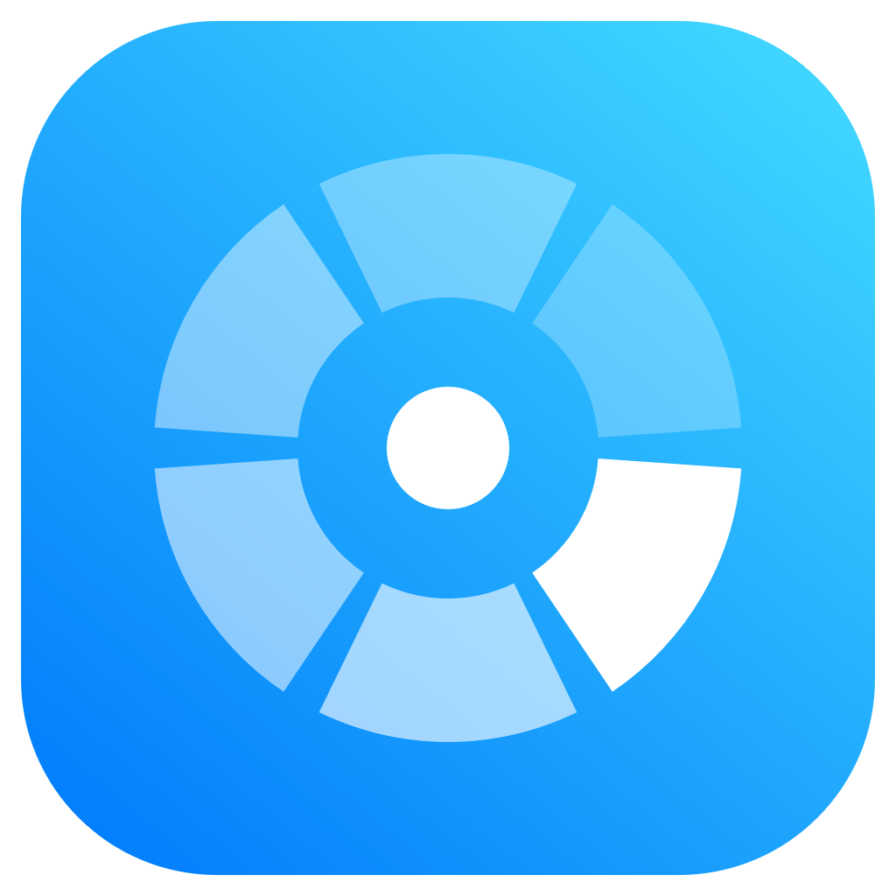
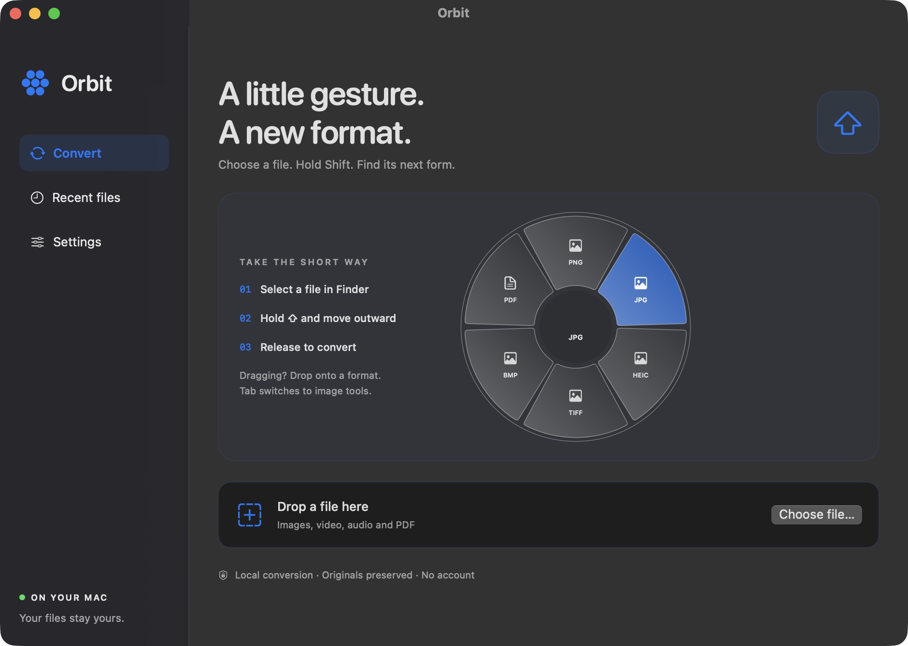

<p align="center"></p>
<h1 align="center">Orbit</h1>
<p align="center">A little gesture. A new format.</p>
<p align="center"><strong>Native file conversion for macOS.</strong><br>Hold Shift in Finder, move into a format, and release.</p>
<p align="center">macOS 15+ · Swift + AppKit + SwiftUI · Local processing</p>
<p align="center"><a href="README.ru.md">Русская версия</a> · <a href="docs/INTERACTION.md">Interaction & architecture</a> · <a href="docs/ROADMAP.md">Roadmap</a> · <a href="CHANGELOG.md">Release notes</a></p>

<p align="center"></p>

## What it does

Orbit brings a contextual conversion wheel to your files. It reads the actual contents of images and the available audio/video streams, then offers relevant output formats. A video with no audio track never offers MP3. A video never offers TXT.

- A Liquid Glass wheel on macOS 26+ (system blur on macOS 15), with translucent segments with a safe center and system accent highlighting.
- Shift + pointer movement for selected Finder/desktop files, and native Shift + drag-and-drop from compatible apps.
- A conventional file picker and a drop area, without Finder permissions.
- Three contextual menus with visible key hints: **⇧ Convert · ⌘ Tools · ⌃ Actions**. Tab cycles menus, and native drags keep the wheel open after the key is released.
- Audio/video trimming from the main window or the wheel: playback, video thumbnails or an actual audio waveform, draggable range handles, precise timecodes and export format selection.
- Save a video clip without audio, or export just the selected audio segment.
- File actions: AirDrop, a floating Quick Look preview, Copy, Move, Copy Path and opening the containing folder in Terminal.
- Image cropping, clockwise rotation, JPEG compression, file information and opening in Preview for annotations.
- A background editor with gradient, padding, rounded corners and shadow.
- A logo on backgrounds: Orbit by default, bottom right; disable it, import your own image, or choose any corner.
- Blue/cyan branding, with interactive highlights following the macOS accent color. Light/dark appearance follows macOS.
- System language by default, with an immediate English / Russian override in Settings. Some technical errors use English. See the [settings preview](docs/settings-en.jpg).
- Launch at login using the macOS login-item service; starts quietly in the menu bar.
- Convert from Finder/desktop without opening Orbit or stealing focus; background errors are available from the menu bar.
- Cancel media conversion, reveal results in Finder, and view the last ten results during the current session.

## Run

Requires macOS 15 or newer and Xcode 26+ or compatible Command Line Tools with the macOS 26 SDK or newer.

```sh
# Optional, strongly recommended for MP3 and the full media feature set.
brew install ffmpeg

# Build a self-contained application bundle (not including FFmpeg).
./scripts/build.sh
open dist/Orbit.app
```

Keep the app at a stable location before enabling permissions; moving/rebuilding an ad-hoc signed app can require granting them again. Move `dist/Orbit.app` into Applications before enabling **Settings → Launch at login**.

For development, open `Package.swift` in Xcode. Prefer the app bundle for Finder automation; running a bare executable may attribute permissions to your terminal or development tool.

## Use the wheel

1. Open Orbit → Settings. Enable **Accessibility** to observe Shift, and **Automation** to read the Finder selection. macOS asks you to grant both permissions. No Full Disk Access or Screen Recording is needed.
2. Select **one** supported file in Finder or on the desktop.
3. Hold **Shift**. The wheel opens around the pointer. Move outward into a format and release Shift to convert.
4. While the wheel is open, press **Command** for Tools or **Control** for Actions; **Shift** returns to formats. Release Shift over the desired item to apply it. The top strip also has clickable menu buttons.
5. During a native drag, tap **Shift**, **Command** or **Control** and **drop onto a sector**. You may release the key while continuing to drag: the wheel stays open until drop/cancel. Releasing a key does not start the operation.
6. **Tab** cycles all three menus. **Escape**, release over the center, or release outside the wheel cancels. Clicking the center cycles menus. Use arrow keys and Return for keyboard navigation.

The desktop is supported alongside Finder windows. In other apps, use Shift during a native file drag: the source must supply a real local file URL. Web links, virtual items and file promises without a local file are not supported. Those apps do not need a separate Automation permission.

The wheel stays on the current display and moves inward near an edge. Closing the main window keeps Orbit in the menu bar. Use **Quit Orbit** to exit, or pause the Finder gesture from the menu bar.

You can also choose or drop a file in Orbit and click **Convert** or **Open wheel**, without granting Finder permissions. Drops containing multiple files are not supported. The app converts one file at a time.

## Trim audio and video

Choose a media file → **Tools → Trim**, or open the wheel with Shift → **⌘ Tools → Trim**. Both open the same editor.

- Drag the blue start/end handles, or enter seconds, `MM:SS.mmm` or `HH:MM:SS.mmm`. Click the timeline to seek; **Space** plays the selected range. Start/end-at-playhead buttons and Reset are also available.
- Video uses a real frame strip; audio uses locally decoded waveform peaks. Formats that macOS cannot play get a temporary local preview through FFmpeg. Preparing that preview can take time for long files; it is removed when the editor closes.
- Choose MP4/MOV for video or M4A/MP3/WAV/FLAC for audio, according to the available engine. A video with sound can export only the selected audio range. **Remove audio** creates a silent video clip.
- **Save clip** creates `name-trimmed.ext` beside the source; existing names receive a number. Cancel stops an export and removes unfinished output. Trimming re-encodes the selection; cuts follow frame/sample boundaries, and compressed audio may include a small encoder delay.

## File actions

Use **⌃ Actions** in the wheel or **Actions** in the main window. **Float** opens a resizable system preview above other windows. **Copy** places the file on the clipboard; **Copy Path** copies its full path. **Move** asks for a destination folder and refuses to replace an existing file. It intentionally moves the selected original. **Terminal** opens its containing folder without executing the file. **AirDrop** opens macOS's recipient interface; nothing is sent until you choose a recipient. Actions apply to the one supported file currently selected in Orbit.

## Formats

| Input | Output | Engine / notes |
|---|---|---|
| Single-frame images readable by ImageIO, e.g. PNG, JPEG, HEIC, TIFF, BMP | PNG, JPG, HEIC, TIFF, BMP, PDF | Native ImageIO/CoreGraphics; formats available on this Mac; current extension omitted |
| PDF | PNG, JPG, TXT | Every page becomes an image in a new `.pages` folder; TXT requires an existing text layer |
| Video supported by FFmpeg | MP4, MOV; MP3, M4A, WAV, FLAC if audio is present | FFmpeg; H.264/AAC for video, quality MP3 encoding |
| Audio supported by FFmpeg | MP3, M4A, WAV, FLAC | FFmpeg; current extension omitted |
| Media playable by macOS, without FFmpeg | MP4, MOV, M4A, according to input type | AVFoundation fallback; some input codecs cannot export |

Known media input extensions: MOV, MP4, M4V, MKV, WEBM, AVI, MPG, MPEG, MP3, M4A, WAV, AIF, AIFF, FLAC, OGG, AAC, OPUS. Extension alone is not enough: playable streams must be present. FFmpeg and ffprobe are discovered in `/opt/homebrew/bin`, `/usr/local/bin` or `Orbit.app/Contents/Helpers`.

## Files & privacy

- Conversion and editing are local. No accounts, analytics or automatic uploads. AirDrop is an explicit action handled by macOS.
- Results are saved beside the input. Existing filenames receive a number. Originals are never overwritten or deleted by conversion.
- Conversion writes to a temporary sibling first, then publishes the result. Failure/cancellation removes its temporary output. Force-quitting or power loss may leave a hidden `.orbit-*` temporary item.
- Image conversion applies EXIF orientation and creates fresh metadata. It does not preserve EXIF/GPS fields. JPG/BMP flatten transparency onto white. JPEG compression is lossy and is saved only when the result is smaller.
- PDF page images are rendered at up to 2× page points, capped at 4096 pixels on the longer side. Image inputs above 100 megapixels, animated/multipage images and encrypted PDFs are rejected. Scanned PDFs need external OCR.
- Background output is PNG, capped at 8192 pixels per side; very large images may be reduced. The logo becomes part of the exported pixels.
- Recent results stay in memory until quit. Only the Finder integration and language preferences are persisted. macOS manages the login-item preference.
- **Open in Preview** opens the source in Apple's editor. Saving there follows Preview's own behavior; it is not a protected Orbit conversion.

## Build, test, package

```sh
swift test
./scripts/build.sh debug
./scripts/package.sh   # dist/Orbit-macOS.zip
```

The 36 automated tests cover app behavior, menu geometry/accessibility, contextual tools, safe moves, timecode validation, waveform decoding, real audio/video trimming, silent video export, native AVFoundation trimming, cancellation and original/existing-file preservation, alongside image/PDF/media conversion. Media fixtures need FFmpeg and skip when it is absent. Finder permissions, native drag sessions, AirDrop recipients and editor UI require a manual pass; see [the checklist](docs/INTERACTION.md#manual-checklist).

Builds target the architecture of the Mac doing the build. The build script signs the local bundle. The project has no paid-service dependency and bundles no third-party binaries.

## GitHub

The repository includes a macOS CI workflow, MIT license, a changelog, issue-ready development notes and an ignore file for builds and signing credentials. CI runs tests and uploads an app ZIP as an artifact; it does not publish a GitHub Release or notarize the app.

Source: [kylebRka/orbit](https://github.com/kylebRka/orbit). App downloads: [Releases](https://github.com/kylebRka/orbit/releases).

```sh
git clone https://github.com/kylebRka/orbit.git
cd orbit
./scripts/build.sh
```

FFmpeg installed separately with Homebrew is not redistributed by this project. Review the licenses of any FFmpeg build you decide to bundle.

## License

[MIT](LICENSE). Apple system frameworks and any separately installed media tools retain their own licenses.
