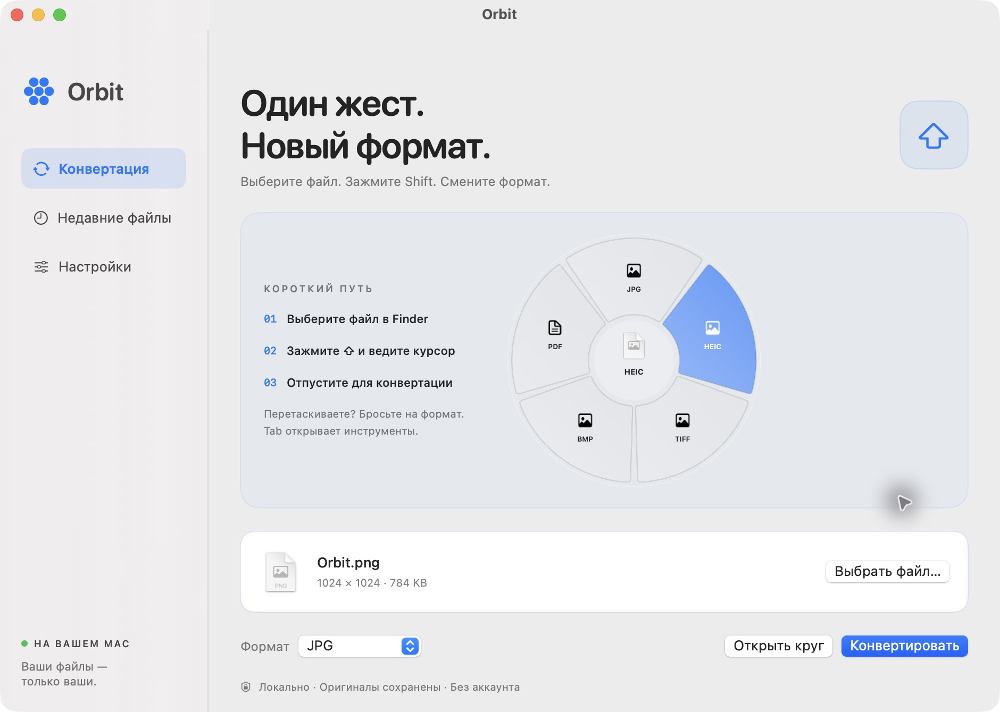

<p align="center"></p>
<h1 align="center">Orbit</h1>
<p align="center">Один жест. Новый формат.</p>
<p align="center"><strong>Нативная конвертация файлов на Mac.</strong><br>Зажмите Shift в Finder, наведите на формат и отпустите.</p>
<p align="center">macOS 15+ · Swift + AppKit + SwiftUI · Всё локально</p>
<p align="center"><a href="README.md">English</a> · <a href="docs/INTERACTION.md">Управление и устройство</a> · <a href="docs/ROADMAP.md">Планы развития</a></p>

<p align="center"></p>

## Возможности

Orbit открывает круговое меню рядом с курсором и предлагает форматы, подходящие выбранному файлу. Приложение проверяет содержимое изображений и дорожки медиа: у видео без звука нет пункта MP3, у видео нет пункта TXT.

- Liquid Glass на macOS 26+ и системное размытие на macOS 15: полупрозрачные сектора, безопасным центром и системным акцентным цветом.
- Выбор файла в Finder → Shift → движение к сектору → отпускание Shift.
- Нативное перетаскивание с Shift на рабочем столе и в совместимых приложениях: бросьте файл в нужный сектор.
- Обычный выбор файла и перетаскивание в окно без разрешений Finder.
- Обрезка изображения, поворот по часовой стрелке, JPEG-сжатие, сведения о файле и разметка через «Просмотр».
- Редактор фона: градиент, отступы, скругления и тень.
- Логотип на фоне: по умолчанию Orbit справа внизу. Можно отключить, заменить своим изображением и выбрать любой угол.
- Сине-голубой фирменный стиль. Выделение следует акцентному цвету macOS, тема — системному оформлению.
- По умолчанию язык системы; в настройках можно сразу переключиться на English или Русский. Часть технических ошибок — на английском. [Настройки на английском](docs/settings.png).
- Автозапуск через системную службу macOS: тихо, в строке меню.
- Конвертация из Finder/с рабочего стола без открытия Orbit и перехвата фокуса; ошибки фоновых операций доступны в строке меню.
- Отмена медиаконвертации, показ результата в Finder, десять последних результатов текущего сеанса.

## Запуск

Нужны macOS 15 или новее и Xcode 26+ либо совместимые Command Line Tools с SDK macOS 26 или новее.

```sh
# Необязательно, но рекомендуется для MP3 и остальных медиаформатов.
brew install ffmpeg

# Сборка приложения; FFmpeg внутрь не включается.
./scripts/build.sh
open dist/Orbit.app
```

Перед выдачей разрешений оставьте приложение в постоянном месте. Перенесите `dist/Orbit.app` в «Программы» перед включением **Настройки → Запускать при входе в систему**. Перемещение или пересборка приложения с локальной подписью иногда требует выдать разрешения заново.

Для разработки откройте `Package.swift` в Xcode. Для работы в Finder запускайте собранный `.app`: при запуске отдельного исполняемого файла macOS может выдать разрешения терминалу или среде разработки.

## Управление

1. Откройте Orbit → **Настройки**. Включите **Универсальный доступ** для наблюдения за Shift и **Автоматизацию** для чтения выделения Finder. Разрешения выдаёт пользователь в системных диалогах. Запись экрана и полный доступ к диску не нужны.
2. Выберите **ровно один файл** в Finder или на рабочем столе.
3. Зажмите **Shift**, наведите курсор на сектор и отпустите Shift: начнётся конвертация.
4. Если файл перетаскивается, удерживайте Shift и **бросьте его в сектор**. Меню принимает системное перетаскивание как копирование. Отпускание Shift во время перетаскивания само по себе не запускает конвертацию.
5. **Tab** переключает форматы и инструменты. **Escape**, центр круга и отпускание за его пределами отменяют действие. Для управления меню из Orbit доступны стрелки и Enter.

Рабочий стол поддерживается наравне с окнами Finder. В других приложениях используйте Shift во время перетаскивания: приложение должно передать настоящий локальный файл через системный drag-and-drop. Веб-ссылки, виртуальные объекты и отложенные вложения без локального файла не поддерживаются; отдельное разрешение «Автоматизация» для этих приложений не требуется.

Около края экрана круг сдвигается внутрь текущего дисплея. Закрытие окна оставляет Orbit в строке меню. Там можно приостановить жест или полностью завершить приложение.

Без разрешений Finder выберите или перетащите файл в окно Orbit, затем нажмите **Конвертировать** или **Открыть круг**. Обрабатывается один файл за раз; перетаскивание нескольких файлов не поддерживается.

## Форматы

| Входной файл | Результат | Примечание |
|---|---|---|
| Однокадровые изображения ImageIO: PNG, JPEG, HEIC, TIFF, BMP и другие | PNG, JPG, HEIC, TIFF, BMP, PDF | Нативные средства macOS; доступны форматы этого Mac, текущий формат исключён |
| PDF | PNG, JPG, TXT | Все страницы — в новую папку `.pages`; TXT требует текстового слоя |
| Видео FFmpeg | MP4, MOV; при наличии звука — MP3, M4A, WAV, FLAC | Для видео H.264/AAC |
| Аудио FFmpeg | MP3, M4A, WAV, FLAC | Текущий формат исключён |
| Совместимое с macOS медиа без FFmpeg | MP4, MOV, M4A по типу входного файла | AVFoundation; экспорт возможен не для всех кодеков |

Распознаются медиа с расширениями MOV, MP4, M4V, MKV, WEBM, AVI, MPG, MPEG, MP3, M4A, WAV, AIF, AIFF, FLAC, OGG, AAC, OPUS. Помимо расширения проверяются реальные дорожки. FFmpeg и ffprobe ищутся в `/opt/homebrew/bin`, `/usr/local/bin` и `Orbit.app/Contents/Helpers`.

## Файлы и приватность

- Всё обрабатывается локально. Нет аккаунтов, отправки файлов, аналитики и сетевых запросов приложения.
- Результат сохраняется рядом с исходником. Совпадающие имена получают номер. Конвертация не перезаписывает и не удаляет оригиналы.
- Сначала создаётся временный файл, затем готовый результат. При ошибке и отмене временный результат удаляется. После принудительного завершения или отключения питания может остаться скрытый `.orbit-*`.
- При конвертации изображений учитывается EXIF-ориентация, метаданные EXIF/GPS не переносятся. Прозрачность JPG/BMP заменяется белым фоном. JPEG-сжатие — с потерями; копия сохраняется, только если она меньше исходника.
- Страницы PDF растеризуются с масштабом до 2× и ограничением 4096 пикселей по длинной стороне. Изображения более 100 мегапикселей, зашифрованные PDF, анимированные и многостраничные изображения не поддерживаются. Для сканированного PDF нужен внешний OCR.
- Фон сохраняется в PNG, максимум 8192 пикселя по стороне: очень большие изображения могут уменьшаться. Логотип становится частью пикселей результата.
- История живёт в памяти до выхода; на диск сохраняются только включение интеграции Finder и язык. Автозапуском управляет macOS.
- **Разметка через «Просмотр»** открывает оригинал в приложении Apple. Сохранение там подчиняется правилам «Просмотра» и не является защищённой конвертацией Orbit.

## Сборка, тесты и архив

```sh
swift test
./scripts/build.sh debug
./scripts/package.sh   # dist/Orbit-macOS.zip
```

23 теста проверяют фоновое завершение без открытия окна, ошибки, устаревший выбор, язык и определение автозапуска, а также геометрию круга, подбор форматов, видео без звука, настоящую конвертацию MOV → MP4/MP3/M4A/WAV/FLAC, изображения, страницы PDF, ошибочные входные данные, отмену и сохранность существующих файлов. Медиатесты пропускаются, если FFmpeg не установлен. Разрешения Finder, системное перетаскивание и редактор проверяются вручную по [чек-листу](docs/INTERACTION.md#ручная-проверка).

Сборка выполняется для архитектуры текущего Mac. Скрипт подписывает локальную сборку. Платные сервисы не требуются. Сторонние исполняемые файлы в сборку не включаются.

## Подготовка к GitHub

В проект включены CI для macOS, лицензия MIT, журнал изменений, описание устройства и `.gitignore`, исключающий сборки и файлы подписи. CI проверяет проект и загружает ZIP приложения как артефакт. Автопубликации Release и нотариализации нет.

Код: [kylebRka/orbit](https://github.com/kylebRka/orbit). Готовые сборки: [Releases](https://github.com/kylebRka/orbit/releases).

```sh
git clone https://github.com/kylebRka/orbit.git
cd orbit
./scripts/build.sh
```

Этот проект не распространяет FFmpeg, установленный отдельно через Homebrew. Если решите включать FFmpeg в сборку, проверьте лицензии конкретного бинарного файла и его библиотек.

## Лицензия

[MIT](LICENSE). Системные компоненты Apple и отдельно установленный FFmpeg сохраняют собственные лицензии.
